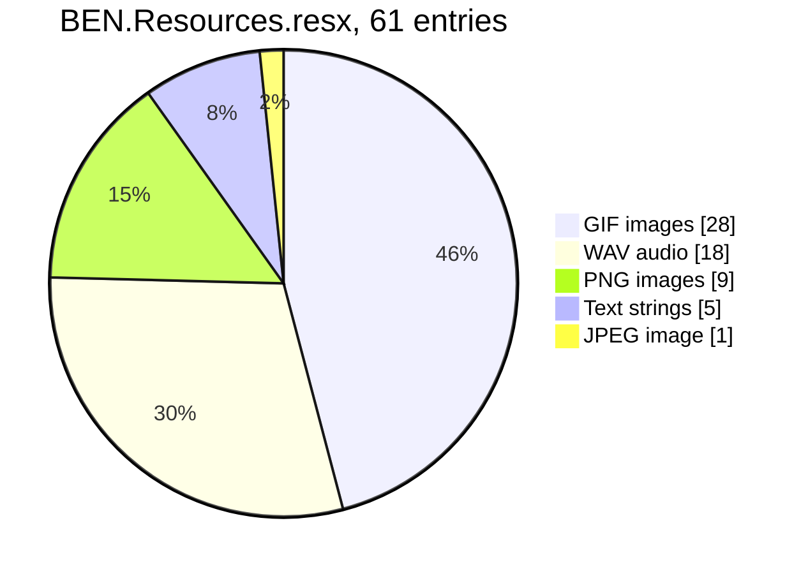
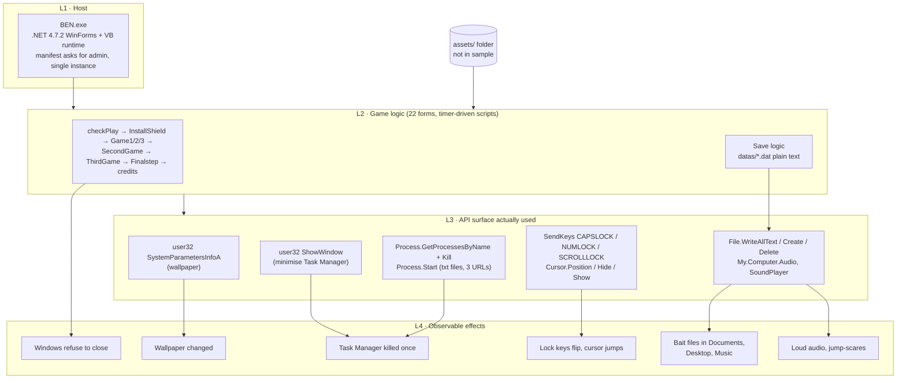
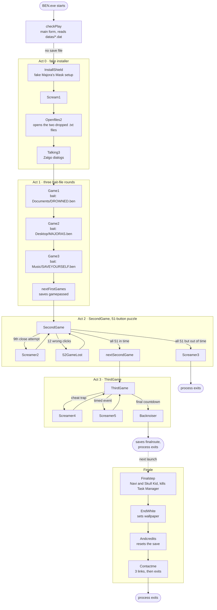
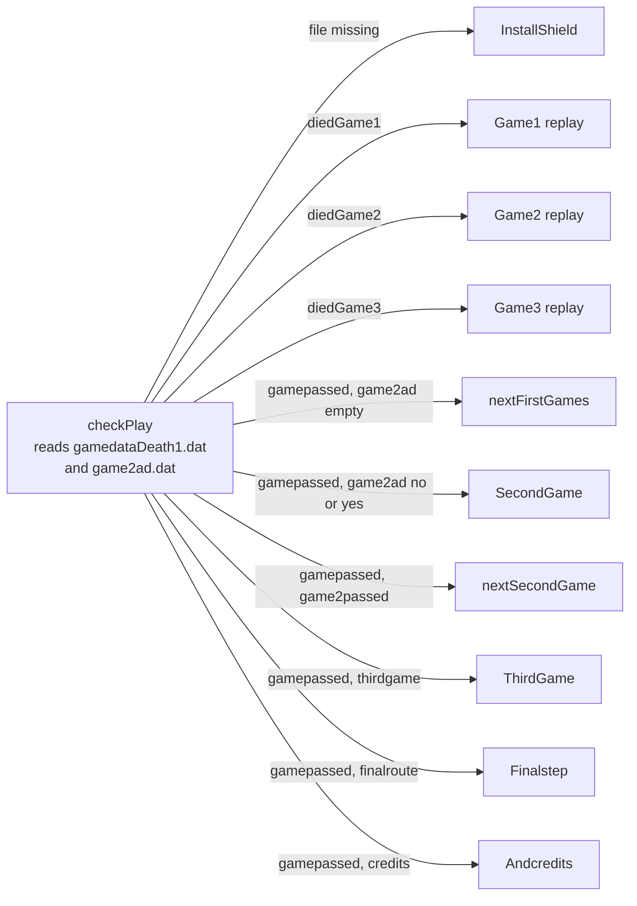
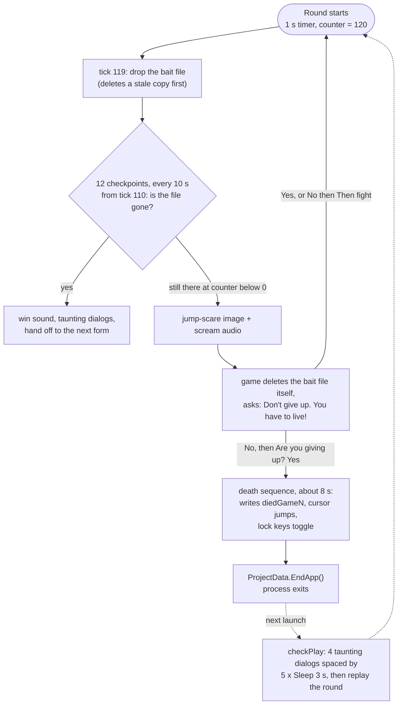
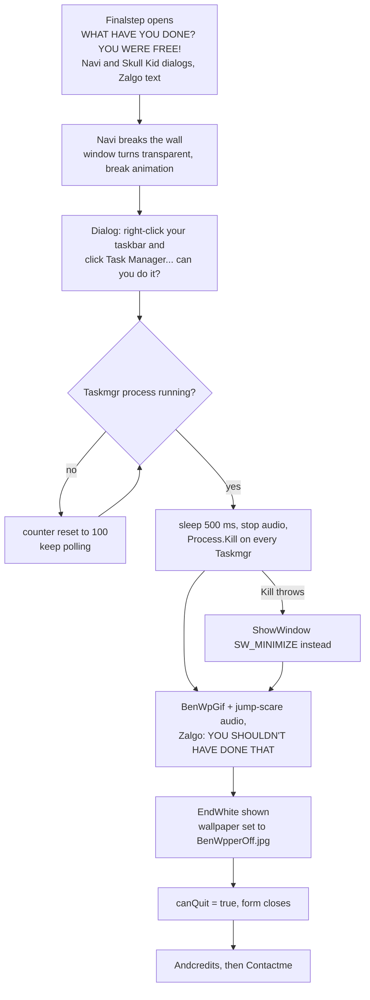

# BEN (fake "Majora's Mask" installer) — reverse-engineering report

> *"there in my malware right now"* — IShowSpeed

A static teardown of a WinForms horror game in the Ben Drowned / creepypasta style. It opens as a fake
*Legend of Zelda: Majora's Mask* installer, then reaches outside its window: it drops "delete me" files into
your Documents, Desktop and Music folders, kills Task Manager once, blocks window close, flips Caps Lock,
jumps the cursor and changes the Windows wallpaper.

**Links found inside the program** (Contact screen, opened only on click; the author attribution is an inference):

* Discord: <https://discord.gg/sttjmY9PUB>
* YouTube: <https://www.youtube.com/c/Jeremzed>
* GameJolt: <https://gamejolt.com/@NayTeeGame>

**Verdict.** Not malware. It is a scripted "meta-horror" game that *imitates* malware: no network code, no
persistence keys, no data collection, no self-copying and no destructive payload. It is, however,
*intrusive*; the full list of effects is in [§4](#4-everything-it-does-to-your-machine) and a cleanup guide is
in [§7](#7-cleanup--reset).

> **Method.** Everything below comes from static review of the decompiled source (a VB.NET project that was
> decompiled to C#). I did not build or run it, and no compiled `BEN.exe` was available. Where this report
> states runtime behaviour, it is read straight from the code; unverified items are called out in
> [§9](#9-limits-and-open-questions).

---

## 1. What is in the package

The sample is a decompiled **source tree**, not a binary: 79 files, 42.3 MB, 27 `.cs` files (≈14.2 k lines)
plus designers, resources and the project files.

| File | Size | SHA-256 | What it is |
|---|---:|---|---|
| `BEN.sln` | 985 | `82c5987fcf6b09d5110fdc2b09cbf573e045648110c1d3d724dd945838710c5c` | Solution file |
| `BEN/BEN.csproj` | 10,443 | `2b159b1f1cd8d9eafa6c5a961267230765116626b6c8be61a7a4b3c09548eac3` | `WinExe`, **.NET Framework 4.7.2**, AnyCPU, assembly name `BEN`, project GUID `{A940D9FE-0029-4C46-B043-3D3374838567}`, startup object `BEN.My.MyApplication` |
| `BEN/app.manifest` | 3,481 | `e70ae3a69c0af278546f748f5e4732806867a02d17d846d09c1975d5adc99a0a` | `requestedExecutionLevel level="requireAdministrator"` (line 19) |
| `BEN/Properties/AssemblyInfo.cs` | 655 | `ad08dc63e721b7622155c88cd181dca9943d5e487e81e86913c53f75c3a0c619` | **False metadata**: Company `Nintendo`, Product `Majora's Mask`, Copyright `© Nintendo 2021`. Assembly GUID `32555571-0d0e-4cd6-8ad5-d4d6351201d9` |
| `BEN/My/Resources/BEN.Resources.resx` | 37,517,465 | `509f4a8914ac3cfb85489af23d89e65278ca739fede3d7a8351e62cb05406a2e` | 61 embedded entries: 56 binary blobs (GIF/PNG/WAV/JPEG) + 5 text strings |
| `BEN/ThirdGame.resx` | 3,454,518 | `e7c15291fb19cc920b113feb3ad2450ea93815ae0d3b221e3bdbb5176660ad71` | 4 form-embedded images |
| `BEN/InstallShield.resx` | 331,886 | `8d271903b5d37943b18da2246cd6483f4ad59e381894e0dd450d3a8b36343e9a` | 2 form-embedded images |
| `BEN/BEN.ico` | 178,645 | `b91505afec8c0340f155597f73e1a13d3849fe6cd5ff982432507a34bbafa2fa` | Application icon |
| `BEN/*.cs` | — | — | 22 forms (`checkPlay` is the main form), VB `My.*` boilerplate |

**Tree hash** of all 79 files (so this exact sample can be identified later):

```text
654b8d6364478cca8a727b40fdc4f5046ae12fb4156468a18c4ddeb9f0ef2bbe
```

Reproduce from the sample folder, ignoring this README and the older `BEN_Reverse_Engineering_Report.md`:

```bash
find . -type f ! -name README.md ! -name BEN_Reverse_Engineering_Report.md ! -path './tools/*' -print0 \
  | LC_ALL=C sort -z | xargs -0 sha256sum | sha256sum
```

**Not in the sample:** the compiled `BEN.exe` and the `assets/` and `datas/` folders. The code loads roughly
70 media files from `<install>\assets\` and reads/writes `<install>\datas\`, so without those folders the
program would crash (for example `InstallShield`'s constructor calls `ReadAllText(datas\fnshd.dat)` with no
existence check).

**Embedded resources** (`BEN.Resources.resx`, all decoded and inspected, no PE headers found in any blob):



---

## 2. The layers

The game is a stack. Each layer reaches the OS only through the one below it.



The only two P/Invokes in the whole project are `SystemParametersInfoA` ([`EndWhite.cs:58`](BEN/EndWhite.cs))
and `ShowWindow` ([`Finalstep.cs:392`](BEN/Finalstep.cs)), both from `user32`.

---

## 3. The game logic

### 3.1 Boot and the cross-launch save state

[`MyApplication`](BEN/My/MyApplication.cs) makes `checkPlay` the main form and enforces a single instance.
`checkPlay_Load` reads two plain-text files in `<install>\datas\` and decides where to resume:

| `gamedataDeath1.dat` | `game2ad.dat` | Resumes at |
|---|---|---|
| missing | — | `InstallShield` (fresh install) |
| `diedGame1` / `diedGame2` / `diedGame3` | — | "So you're back" dialogs spaced by 5 × `Sleep(3000)`, then replays Game1 / Game2 / Game3 |
| `gamepassed` | `no` or `yes` | `SecondGame` (`alreadyDead` = false / true) |
| `gamepassed` | `game2passed` | `nextSecondGame` |
| `gamepassed` | `thirdgame` | `ThirdGame` |
| `gamepassed` | `finalroute` | `Finalstep` |
| `gamepassed` | `credits` | `Andcredits` |
| `gamepassed` | empty | `nextFirstGames` |

Who writes what (all `File.WriteAllText`, errors swallowed):

| File | Value | Written by |
|---|---|---|
| `gamedataDeath1.dat` | `diedGame1/2/3` | death sequences in `Game1.cs:496`, `Game2.cs:419`, `Game3.cs:375` |
| `gamedataDeath1.dat` | `gamepassed` | `nextFirstGames.cs:105` |
| `gamedataDeath1.dat` | empty | created by `InstallShield.cs:142`, reset by `Andcredits.cs:185` |
| `game2ad.dat` | `yes` | `SecondGame.cs:3470,3522` |
| `game2ad.dat` | `game2passed` | `SecondGame.cs:3493` |
| `game2ad.dat` | `thirdgame` | `nextSecondGame.cs:210,250` |
| `game2ad.dat` | `finalroute` | `ThirdGame.cs:2793` |
| `game2ad.dat` | `credits` | `EndWhite.cs:132` |
| `game2ad.dat` | `no` | reset by `Andcredits.cs:175` |
| `fnshd.dat` | `yes` / empty | `EndWhite.cs:142` / `InstallShield.cs:196,310` |
| `game2.dat` | created empty | `InstallShield.cs:156`; never read |

The save is trivially editable: change `game2ad.dat` and you skip ahead.

### 3.2 Form-to-form flow

Solid arrows are in-process transitions (`MyProject.Forms.X.Show()` in the code). Dotted arrows cross a
**process exit**: the game saves a flag, ends the process, and the next start of `checkPlay` resumes there
(see the dispatch graph below).



**Resume dispatch.** On every start, `checkPlay_Load` reads the two save files and jumps to the matching
form. This is what stitches the separate processes into one story:



The `ThirdGame → Backnoiser → exit` path writes `finalroute`, so the **next launch** is what opens
`Finalstep`. That is why the finale only appears after you reopen the program.

### 3.3 The bait-file round (Game1, Game2, Game3)

This is the core mechanic and the reason the game feels like malware. Each round drops a file and the
player must delete it. Shown for `Game1` (1 s timer; `Game2` and `Game3` share the same code shape with
`Desktop\MAJORAS.ben` and `Music\SAVEYOURSELF.ben`).



So you can lose a round only by choosing to give up. Ignoring the file just makes the game delete it for
you and offer a retry.

### 3.4 `Finalstep`: the Task Manager sequence



The kill runs **once**, not as a watchdog. If you never open Task Manager, the polling loop keeps resetting
and the window stays up (its close button is blocked) until the process is ended externally; see
[§7](#7-cleanup--reset).

### 3.5 The other stages in one table

| Stage | What the code does |
|---|---|
| `InstallShield` | Fake "TLOZ: Majora's Mask" setup wizard. Close button blocked until `canQuit`. At 10 % and 20 % it writes `WHAT HAVE YOU DONE.txt` and its reversed twin `ENOD UOY EVAH TAHW.txt` into `datas\others\`; it creates the `.dat` files; at 80 % the window title and labels turn into Zalgo text ("Installing BEN"). If `fnshd.dat` already contains `yes` and you press Cancel, you get a taunting message sequence and the process exits. |
| `SecondGame` | A click puzzle: 51 buttons, 12 allowed mistakes (title bar shows `n/51 - m ERRORS LEFT`), 60-second limit. Trying to close the window is counted (`trytoquit`) with taunts like "yOu SUrRenDED To mE"; the 9th attempt shows `Screamer2`. |
| `ThirdGame` | Has a mouse trap (`triggerCheater_MouseEnter`) that shows `Screamer4` and resets you, and a timed sequence that shows `Screamer5`. A final "decompose" countdown shakes the form, writes `finalroute`, shows `Backnoiser` and exits. Only the transition regions were read, not the whole 92 KB file ([§9](#9-limits-and-open-questions)). |
| `Finalstep` | See §3.4. |
| `EndWhite` | Sets the wallpaper (`SystemParametersInfoA`, action 20, flag `SPIF_UPDATEINIFILE`), writes `credits` / `yes`, fades out into `Andcredits`. |
| `Andcredits` | Credits, **resets the save** (`game2ad.dat` ← `no`, `gamedataDeath1.dat` ← empty), then `Contactme`. |

---

## 4. Everything it does to your machine

| # | Effect | Mechanism | Where |
|---|---|---|---|
| 1 | **Asks for admin rights** | Manifest `requireAdministrator` → UAC prompt | `app.manifest:19` |
| 2 | **Drops bait files** into Documents, Desktop, Music | `File.WriteAllText` to `SpecialDirectories.MyDocuments / Desktop / MyMusic` | `Game1.cs:230-234`, `Game2.cs:141-145`, `Game3.cs:121-125` |
| 3 | **Writes and opens text files** | `File.WriteAllText` into `datas\others\`, then `Process.Start` on them | `InstallShield.cs:118,129`; `Openfiles2.cs:112,122` |
| 4 | **Kills Task Manager** (once) | `Process.GetProcessesByName("Taskmgr")` → `Kill()`, fallback `ShowWindow(SW_MINIMIZE)` | `Finalstep.cs:387-451` |
| 5 | **Blocks window close** | `FormClosing` sets `e.Cancel = true` until a script flag flips | `Finalstep.cs:617`, `Game1.cs:651`, `InstallShield.cs:329`, `Game2/3` |
| 6 | **Changes the wallpaper**, never reverts it | `SystemParametersInfoA(20, …, 1)` → `assets\pictures\BenWpperOff.jpg` | `EndWhite.cs:116-122` |
| 7 | **Jumps the cursor** (25 scripted positions per death sequence) | `Cursor.Position = new Point(…)` | `Game1.cs:517-641` (+ Game2, Game3) |
| 8 | **Toggles lock keys** (Caps Lock ends flipped: 9 toggles, Num/Scroll 8 each) | `SendKeys.Send("{CAPSLOCK}"/"{NUMLOCK}"/"{SCROLLLOCK}")` | `Game1.cs:518-642` (+ Game2, Game3) |
| 9 | **Stalls the UI on relaunch** after a death: 5 × `Thread.Sleep(3000)` (≈15 s) around four modal taunt dialogs | `checkPlay_Load` | `checkPlay.cs:134-186` |
| 10 | **Exits the process hard** at the end of death sequences | `ProjectData.EndApp()` | `Game1.cs:646`, `Game2.cs:569`, `Game3.cs:525`, `Screamer3.cs:88`, `ThirdGame.cs:2829` |
| 11 | **Loud audio and jump-scares**, hidden cursor during scares | `My.Computer.Audio`, `SoundPlayer`, `Cursor.Hide()` | `Screamer*`, `Scream1`, `Finalstep`, others |
| 12 | **Opens 3 URLs** on click only | `Process.Start("https://…")` | `Contactme.cs:143-155` |
| 13 | **Stores progress** | `datas\*.dat` (see §3.1) | many |

Net effects that outlast the program: the **wallpaper**, the **bait files** (if not deleted), the **`datas`
files**, and a possibly **flipped Caps Lock**.

---

## 5. What the bait files say

Verbatim content of the three `.ben` files. They are plain text, not executables; each word sits on its
own line with a blank line between.

**`Documents\DROWNED.ben`**

```text
you

should

delete

this

file.
```

**`Desktop\MAJORAS.ben`**

```text
delete

this

file

too.
```

**`Music\SAVEYOURSELF.ben`**: the words `this`, `is`, `the`, `last.` in the same style, then a long run of
blank lines (scroll bait), then:

```text
for real...? :)
```

`WHAT HAVE YOU DONE.txt` is the line `YOU SHOULDN'T HAVE DONE THAT` repeated; its twin `ENOD UOY EVAH TAHW.txt`
is the same message in Zalgo (stacked combining characters). Both are generated from embedded resources
(`WHAT_HAVE_YOU_DONE`, `ENOD_UOY_EVAH_TAHW`).

---

## 6. What it does not do, and how I checked

| Capability | Found? | Evidence |
|---|---|---|
| Network access | **No** | No `System.Net`, `WebClient`, `HttpClient`, sockets or `WebRequest` anywhere. The only URLs are the three in `Contactme.cs`, opened by user click |
| Registry access / autorun | **No** | No `Microsoft.Win32`, no `Registry`, no `CurrentVersion\Run`. The wallpaper change goes through `SystemParametersInfo`, not direct registry code |
| Persistence (tasks, services, startup folder) | **No** | No `schtasks`, `Startup`, service or WMI code |
| Data theft (keylogger, screenshots, clipboard, credentials) | **No** | No `GetAsyncKeyState`, `SetWindowsHookEx`, `CopyFromScreen`, `Clipboard`; `SendKeys` is output only |
| Ransom / encryption | **No** | No `Rijndael`, `AES`, `Encrypt`, no file enumeration |
| Deleting user files | **No** | `DeleteFile` targets only its own bait files |
| Spreading / self-copy | **No** | No `File.Copy`, no drive or network enumeration (`DriveInfo`, `DriveType`) |
| Dynamic or downloaded code | **No** | No `Assembly.Load`, `Reflection.Emit`, `Convert.FromBase64String`, no `cmd`, `powershell` or `ShellExecute` |
| Embedded executables | **No** | All 62 binary resource blobs decoded: GIF, PNG, WAV, JPEG only; no `MZ` header or DOS-stub string |
| Disk, boot or system damage | **No** | No `\\.\PhysicalDrive`, `NtRaiseHardError`, `bcdedit`, `vssadmin`, `shutdown` |
| Security-tool tampering | **No** | No Defender, firewall (`netsh`) or UAC-bypass code. The manifest only *requests* elevation |
| Collecting or sending your data | **No** | No `Environment.UserName` or `MachineName` reads, and with no network code there is nowhere to send anything |

**How this was checked:** a pattern sweep over every `.cs` file (designers included) for the APIs above,
plus a base64 decode and magic-number check of every `System.Drawing.Bitmap` / `MemoryStream` resource entry
in the three `.resx` files that contain binaries ([`tools/scan_resx.py`](tools/scan_resx.py)). The one hit on
the broad sweep (`WMI`) was `SW_SHOWMINIMIZED`, the `ShowWindow` enum member.

**What this does not prove:** that a compiled `BEN.exe` you downloaded matches this source ([§9](#9-limits-and-open-questions)).

---

## 7. Cleanup / reset

Not destructive, but none of it is automatic. There is nothing in the registry, no service and no scheduled
task to remove.

* **Stuck mid-run** (Task Manager killed, window won't close). From an elevated Command Prompt or
  PowerShell (Win+R → `cmd`):

  ```bash
  taskkill /F /IM BEN.exe
  ```

  Opening Task Manager once, as the game asks, is harmless: it is killed, the scripted sequence finishes,
  `canQuit` flips and the form closes by itself.

* **Bait files:** delete any that remain.

  ```powershell
  Remove-Item "$env:USERPROFILE\Documents\DROWNED.ben", "$env:USERPROFILE\Desktop\MAJORAS.ben", "$env:USERPROFILE\Music\SAVEYOURSELF.ben" -ErrorAction SilentlyContinue
  ```

  (If your Documents, Desktop or Music folders are redirected, for example to OneDrive, check there.)

* **Wallpaper:** *Settings → Personalization → Background*, pick any picture.
* **Caps Lock:** check its state after a death sequence.
* **Replay from the start:** delete `<install>\datas\*.dat`; the installer recreates them.
* **Remove entirely:** delete the game folder (it holds `datas\` and `assets\`).

---

## 8. How this was done

| Task | Tool |
|---|---|
| Reading the decompiled source, API sweeps | Claude Code `Read` and ripgrep (`Grep`) over `BEN\*.cs` |
| Resource blob inspection | [`tools/scan_resx.py`](tools/scan_resx.py) (Python 3, run isolated with `-I`): base64-decodes every binary `<data>` entry, identifies the serialized type and the payload magic number, and flags any `MZ` / DOS-stub string |
| Hashes | `sha256sum` / `Get-FileHash` |

**Reproduce:**

```bash
python -I tools/scan_resx.py BEN/My/Resources/BEN.Resources.resx
python -I tools/scan_resx.py BEN/ThirdGame.resx
python -I tools/scan_resx.py BEN/InstallShield.resx
grep -rnE 'DllImport|Process\.(Start|Kill)|SendKeys|Cursor\.Position|SystemParametersInfo' BEN --include=*.cs
```

### 8.1 File index

```
README.md                        this report
BEN_Reverse_Engineering_Report.md   earlier, shorter write-up (superseded by this README)
tools/scan_resx.py               resource-blob inspector
BEN.sln, BEN/                    the decompiled sample (not modified)
```

---

## 9. Limits and open questions

* **Source only.** There was no compiled `BEN.exe`, so I cannot say a binary you obtained elsewhere is
  identical to this source. If you have it: hash it, decompile it and diff, then run it once in a VM with
  Process Monitor and Regshot to confirm §6 empirically.
* **Not executed.** Nothing was built, run or sandboxed. No antivirus or VirusTotal lookup was done.
* **Coverage.** Read in full or in the relevant regions: `checkPlay`, `InstallShield`, `EndWhite`,
  `Finalstep` (logic), `Game1` / `Game2` / `Game3` (file-drop and death regions), `Andcredits`, `Contactme`,
  `Scream1`, `Openfiles2`, `Talking3`, `Screamer2-5`, `S2GameLost`, `nextFirstGames`, `nextSecondGame`, and
  the transition regions of `SecondGame` and `ThirdGame`. The two large gameplay files (`SecondGame.cs`
  141 KB, `ThirdGame.cs` 92 KB) were otherwise only pattern-scanned, so their puzzle details are not
  documented here.
* **`Game2` / `Game3` timings.** Timer intervals and the 12-checkpoint structure were verified in `Game1`
  (`GameTimer.Interval = 1000`). `Game2` and `Game3` share the same code shape, but their designer intervals
  were not individually checked.
* **Attribution** of the author from the Contact links is an inference, not verified.
* **Antivirus.** An unsigned, admin-elevated executable that changes the wallpaper, kills a system process
  and blocks its own close button looks like a dropper to a heuristic scanner, even though none of the
  harmful capabilities in §6 were found.

---

## Appendix A — every file the game creates

| Path | Created by | Content | Purpose |
|---|---|---|---|
| `%USERPROFILE%\Documents\DROWNED.ben` | `Game1` tick 119 | see §5 | Round 1 bait |
| `%USERPROFILE%\Desktop\MAJORAS.ben` | `Game2` tick 119 | see §5 | Round 2 bait |
| `%USERPROFILE%\Music\SAVEYOURSELF.ben` | `Game3` tick 119 | see §5 | Round 3 bait |
| `<install>\datas\others\WHAT HAVE YOU DONE.txt` | `InstallShield` 10 % | `YOU SHOULDN'T HAVE DONE THAT` repeated | Opened by `Openfiles2` |
| `<install>\datas\others\ENOD UOY EVAH TAHW.txt` | `InstallShield` 20 % | same message, Zalgo | Opened by `Openfiles2` |
| `<install>\datas\gamedataDeath1.dat` | `InstallShield` 30 % and many | state, see §3.1 | Resume point |
| `<install>\datas\game2.dat` | `InstallShield` 40 % | empty | Never read |
| `<install>\datas\game2ad.dat` | `InstallShield` 50 % and many | state, see §3.1 | Resume point |
| `<install>\datas\fnshd.dat` | `InstallShield` 60 % and `EndWhite` | empty / `yes` | "Finished once" flag |
| Desktop wallpaper setting | `EndWhite` | `assets\pictures\BenWpperOff.jpg` | Persistent until you change it |

## Appendix B — readable dialogs outside the game window

Most dialogs use stacked combining characters ("Zalgo") and are unreadable in plain text. The plain ones:

* `Finalstep`: "WHAT HAVE YOU DONE ? YOU WERE FREE !", then Navi: "I have an idea !", "First, I will try to get us out of the dark.", "Alright, I'll use all of my strength to break the wall. Watch out !", "You have to... right click on your taskbar... and click on \"Task Manager\"...", "If you don't, we'll both die forever..."
* `Game1`: "goOD.", "vERy gOOd...", "bUT iT'S nOt OveR yET.", "theRE'S anoTHER fILE. gOOD LucK."; on timeout "Hey ! Don't give up. You have to live !", "Are you giving up already ?", "Then fight !"
* `SecondGame`: "I ThOUGht yoU'D GEt uSEd tO iT", "yOu SUrRenDED To mE", "yOU SHOuLD StOP." (close-attempt taunts); "yOU'rE qUItE goOd.. .", "bUT I foRGOt oNe rULe aBoUT tHis lITTlE gAME" (then "you only had one minute")
* `nextSecondGame`: "dO yoU reGReT ?", "oF coURSe."
* `checkPlay`: "So you're back.", "You decided to continue ?", "Why are you coming back ?", "Giving up and starting over..."

## Appendix C — small details

* **The close-button block is script-only.** There is no native hook: each form's `FormClosing` just sets
  `e.Cancel = true` until a flag (`canQuit`, `canquit`, `noquitLosing`) is flipped by the script.
* **`ProjectData.EndApp()` vs `Close()`.** Death sequences end the whole process, which is what makes the
  game "restart" and why progress is stored in files rather than memory.
* **`game2.dat` is dead state.** It is created by the installer and never read or written again.
* **The metadata lies on purpose.** The Nintendo/Majora's Mask metadata and the fake installer UI are part of
  the in-fiction disguise; they do not indicate Nintendo involvement.
